### About

I work with **SQL, Python, business intelligence, and data pipelines** to develop reliable data solutions, clear reports, and practical insights.

### Technical stack

**Data Engineering**  
       
`SQL Server` · `ETL / ELT` · `Data Warehousing` · `Data Modeling` · `Data Pipelines` · `Data Quality`

**Analytics & BI**  
`Python` · `Pandas` · `Power BI` · `Excel` · `Data Visualization`

**Development**  
`C#` · `Git` · `GitHub`

### Microsoft certifications

| Certification | Credential |
|:--|:--|
| **Microsoft Certified: Fabric Data Engineer Associate** | **DP-700** · [Microsoft Learn](https://learn.microsoft.com/en-us/credentials/certifications/fabric-data-engineer-associate/) |
| **Microsoft Certified: Azure Data Fundamentals** | **DP-900** · [Microsoft Learn](https://learn.microsoft.com/en-us/credentials/certifications/azure-data-fundamentals/) |

### Selected projects

<table>
<tr>
<td width="72" align="center"></td>
<td><b><a href="https://github.com/SaraEldamarany/ITI-Examination-System">ITI Examination System</a></b> C# · SQL Server · SSRS · Power BI</td>
</tr>
<tr>
<td align="center"></td>
<td><b><a href="https://github.com/SaraEldamarany/Sales-DWH-SSIS">Sales Data Warehouse</a></b> SSIS · ETL · SQL Server</td>
</tr>
<tr>
<td align="center"></td>
<td><b><a href="https://github.com/SaraEldamarany/NAFS-Students-Test-Analysis-Dashboard">NAFS Performance Dashboard</a></b> Excel · Data Visualization</td>
</tr>
</table>

### Contribution activity

 

